<div align="center">

# birbTrack

**A website for the birds in your yard.**

BirdNET-Go listens to a microphone outside and names every bird it hears. birbTrack turns that into a
site worth sharing: the day as a dial under the sky as it looked at that hour, a page for every species
with its clearest recording and where it spends each month, and a Discord post when someone new turns up.


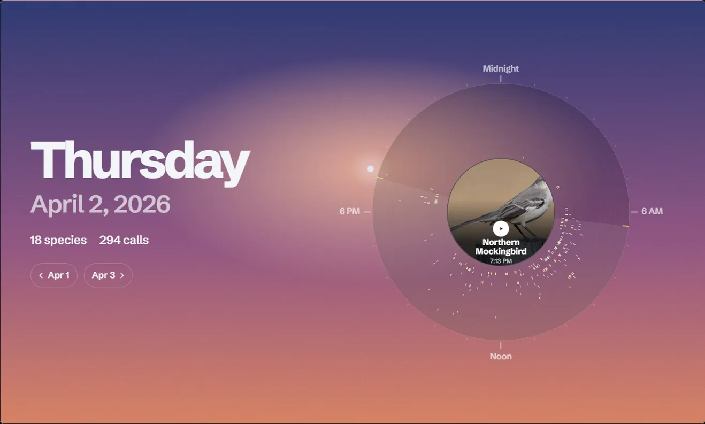

<sub>A real day from the station birbTrack was built for. The call in the middle paints itself as it plays.</sub>

</div>

---

## The pages

<picture>
  <source media="(prefers-color-scheme: dark)" srcset="docs/img/screens/day-dark.jpg">
  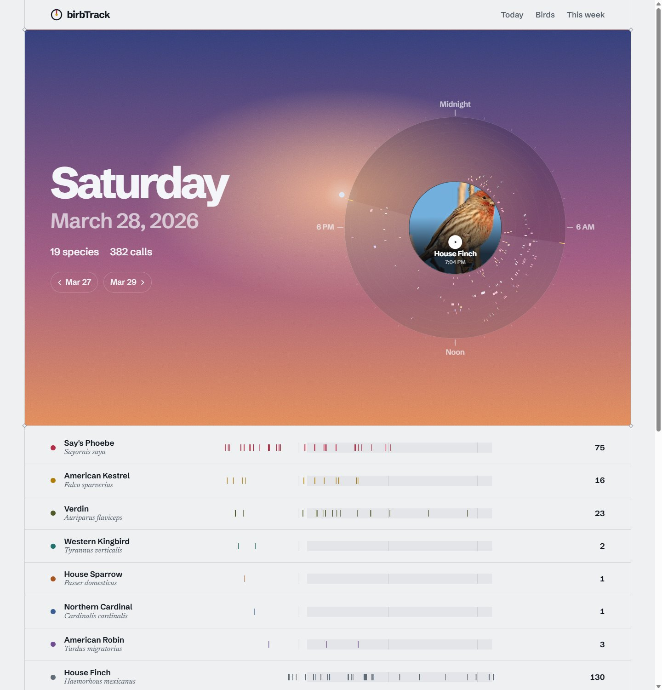
</picture>

| | |
|:---:|:---:|
| 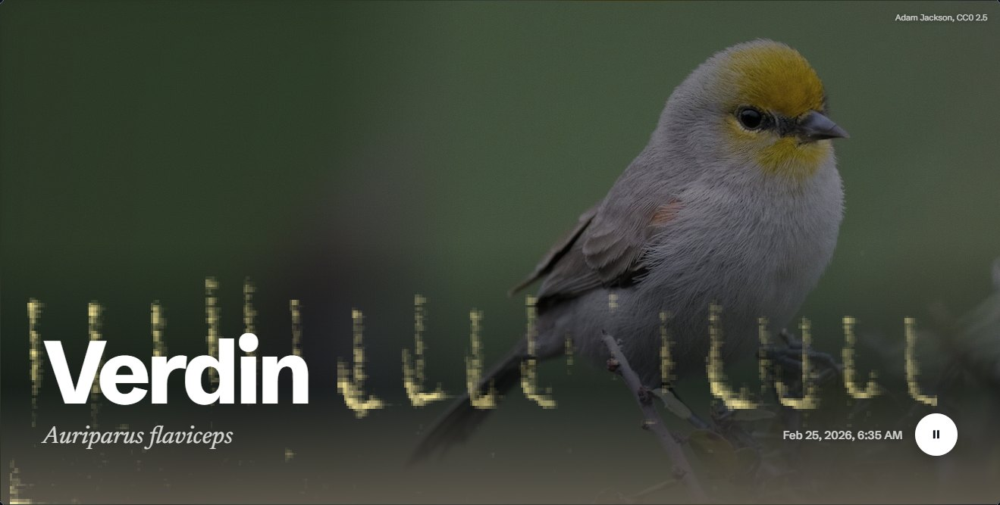<br><sub>A species: its clearest recording paints across the photo in the bird's own colour</sub> | <picture><source media="(prefers-color-scheme: dark)" srcset="docs/img/screens/range-dark.jpg">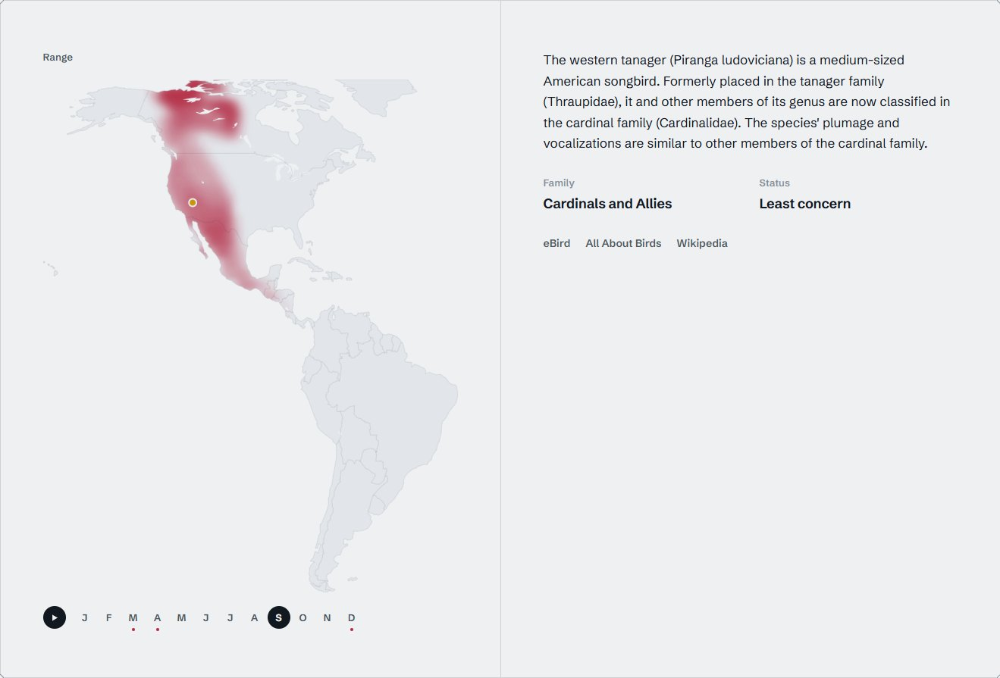</picture><br><sub>Where it is likely, month by month, from BirdNET's own range model</sub> |
| <picture><source media="(prefers-color-scheme: dark)" srcset="docs/img/screens/birds-dark.jpg">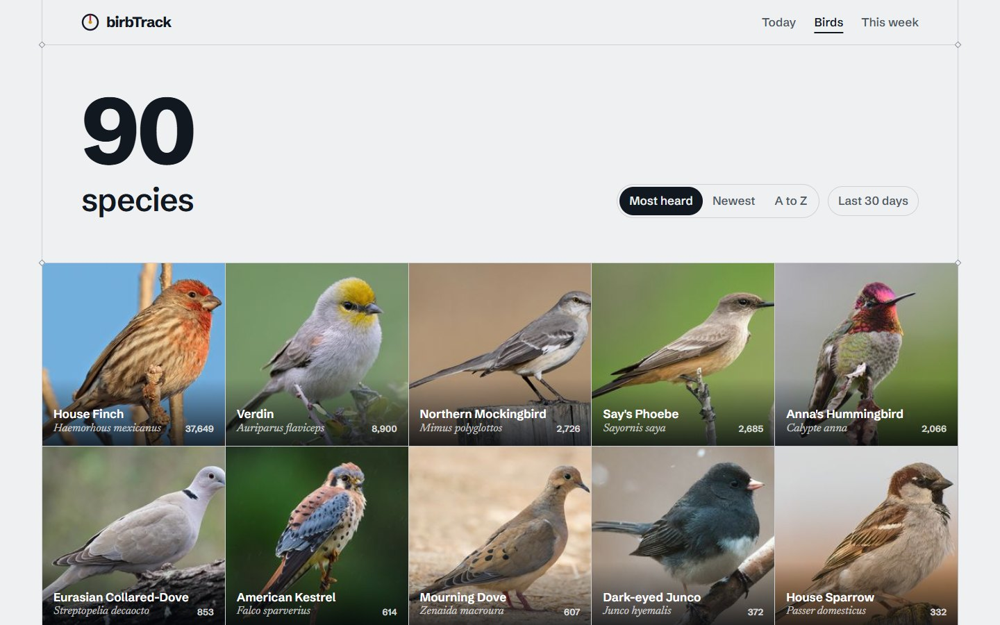</picture><br><sub>The yard list, by most heard, newest or name</sub> | <picture><source media="(prefers-color-scheme: dark)" srcset="docs/img/screens/week-dark.jpg">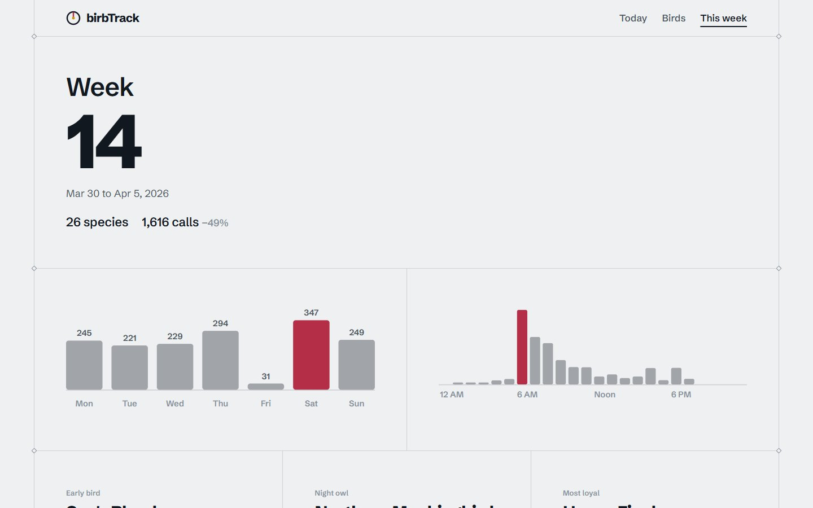</picture><br><sub>A week, the page the Discord report links to</sub> |
| <picture><source media="(prefers-color-scheme: dark)" srcset="docs/img/screens/detection-dark.jpg">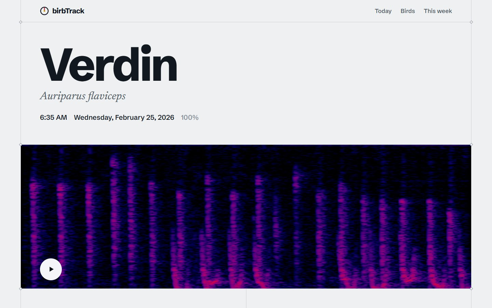</picture><br><sub>One detection, the page a new-bird post links to</sub> | <picture><source media="(prefers-color-scheme: dark)" srcset="docs/img/screens/charts-dark.jpg">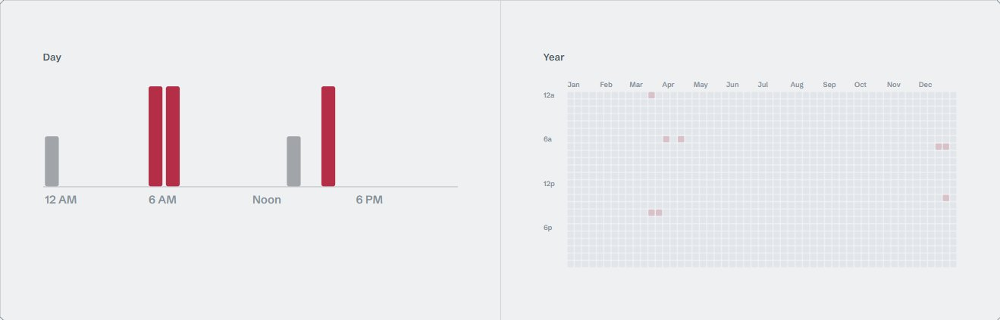</picture><br><sub>When in the day and the year it calls</sub> |

| | | |
|:---:|:---:|:---:|
| <picture><source media="(prefers-color-scheme: dark)" srcset="docs/img/screens/phone-day-dark.jpg">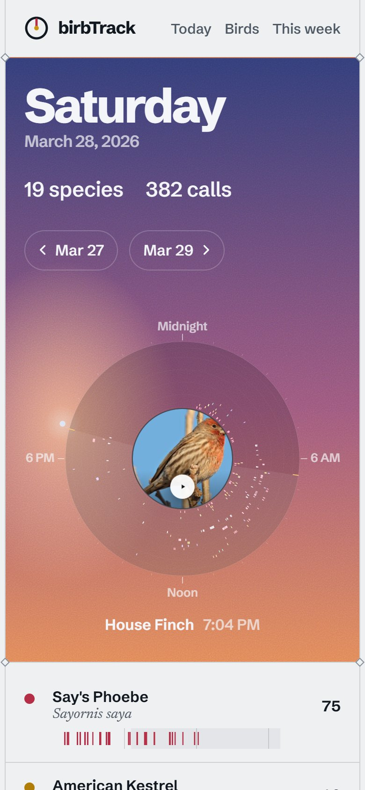</picture> | <picture><source media="(prefers-color-scheme: dark)" srcset="docs/img/screens/phone-bird-dark.jpg">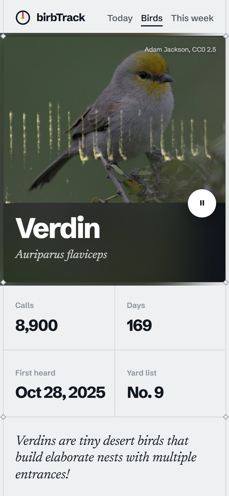</picture> | <picture><source media="(prefers-color-scheme: dark)" srcset="docs/img/screens/phone-range-dark.jpg">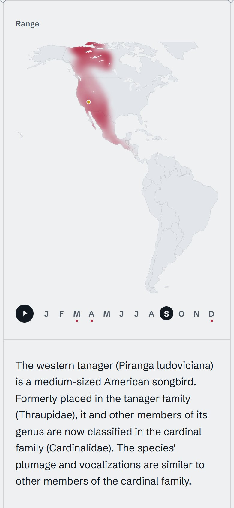</picture> |

<sub>Every screenshot follows your GitHub theme, as the site follows your system's.</sub>

## Contents

[The pages](#the-pages) · [Features](#features) · [How it works](#how-it-works) · [Install](#install) ·
[Configure](#configure) · [Discord](#discord) · [Range maps](#range-maps) ·
[A microphone on a Raspberry Pi](#a-microphone-on-a-raspberry-pi) · [Coming from BirdNET-Pi](#coming-from-birdnet-pi) ·
[Going public](#going-public) · [Development](#development) · [Troubleshooting](#troubleshooting) · [License](#license)

## Features

| | |
|---|---|
| **The day as a dial** | Every call is a tick on a 24-hour ring, one lane per species, sunrise and sunset notched on the rim. The sky behind it is painted for the moment shown: now on today's page, the last call on a past day |
| **Live** | New detections arrive over a server-sent event stream and ripple onto the dial; nothing reloads |
| **Calls that draw themselves** | Play a call from the dial and it paints a ring spectrogram around the bird. Play one on a species page and it paints across the photo, in a colour taken from the photo |
| **A page per species** | Photo, counts, when it was first heard, a fact, its range by month, the Wikipedia introduction, family and conservation status, when in the day and year it calls, its best recordings |
| **Range maps from BirdNET itself** | BirdNET's geomodel sampled over a land grid for your region, month by month: a heatmap of where the bird is likely, your yard marked, the months you heard it dotted. Five regions to choose from |
| **Discord** | A post for a new yard bird and for one back after a long absence, with photo, spectrogram and a link; a weekly report every Monday. Silent at night |
| **Safe to put online** | Read-only, a strict Content Security Policy, nothing loaded from third parties, a per-client rate limit, media served only for known detections. The station's coordinates never reach a browser |
| **Light and dark, phone and desktop** | Follows the system; phones get their own layout, with no sideways scrolling |
| **Small** | FastAPI and httpx on the server, plain JavaScript and SVG in the browser, two self-hosted fonts. One container, one SQLite file |

## How it works

<picture>
  <source media="(prefers-color-scheme: dark)" srcset="docs/img/diagrams/how-it-works-dark.svg">
  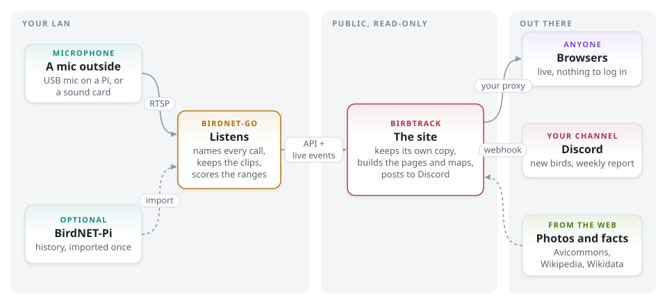
</picture>

BirdNET-Go does the listening: it takes audio from an RTSP stream or a sound card, names what it hears
and keeps a clip of each detection. birbTrack keeps its own copy of the detections in SQLite (a backfill
on first start, BirdNET-Go's live event stream after that, and a sweep every five minutes for anything
missed or deleted) and builds every page from that copy. BirdNET-Go never faces the internet; birbTrack
does, and it only answers GET.

Clips, spectrograms and photos are fetched and cached by birbTrack, so a visitor's browser talks to one
origin and nothing else. A detection marked as a false positive in BirdNET-Go's review leaves the site.

The range maps come from the same model BirdNET-Go uses to decide which species are plausible at a
place and week. For every point of a land grid and every month, birbTrack asks BirdNET-Go for every
species' score (one call returns them all), and keeps one byte per point per month. A full build is
about 9,000 calls and ten minutes; it runs once, and again only when a species without a map turns up.

## Install

You need Docker with Compose and a microphone BirdNET-Go can hear.

```sh
git clone https://github.com/chungus-actual/birbtrack.git
cd birbtrack
cp .env.example .env                        # time zone, public address, Discord webhook
mkdir -p data && sudo chown 1000:100 data   # birbTrack runs as uid 1000
docker compose up -d
```

| Step | How |
|---|---|
| 1. Set up BirdNET-Go | Open `http://<host>:8080`, set the station's location in its settings, and add your audio: an RTSP stream (see [the Pi kit](#a-microphone-on-a-raspberry-pi)) or a sound card (uncomment `devices` in `compose.yaml`) |
| 2. Open the site | `http://<host>:8894`. It fills in as detections arrive |
| 3. Put it online | Point a reverse proxy with TLS at port 8894, and keep 8080 (BirdNET-Go) on your LAN. See [Going public](#going-public) |

Already running BirdNET-Go? Delete the `birdnet-go` service from `compose.yaml` and set `BT_BNG_URL`
to yours. birbTrack is tested against BirdNET-Go 20261014 with its login turned off; birbTrack doesn't log in.

## Configure

Everything is an environment variable, read from `.env` ([example](.env.example)).

| Variable | Default | Meaning |
|---|---|---|
| `TZ` | `UTC` | the station's time zone, the same as BirdNET-Go's |
| `BT_PUBLIC_URL` | `http://localhost:8894` | where people reach the site; Discord posts and link previews point here |
| `BT_PLACE` | `a backyard` | how link previews name the place: "12 species heard in a backyard in Boulder so far today" |
| `BT_BNG_URL` | `http://birdnet-go:8080` | BirdNET-Go's address |
| `BT_LAT`, `BT_LON` | BirdNET-Go's | the station's location, read from BirdNET-Go unless set here |
| `BT_REGION` | `auto` | the range map: `americas`, `europe`, `africa`, `asia`, `oceania`, or the one holding the station |
| `BT_DISCORD_WEBHOOK` | empty | a channel webhook; empty means no posts |
| `BT_DISCORD_NAME` | `birbTrack` | the name the posts appear under |
| `BT_NOTIFY` | `lifer,comeback,weekly` | which posts to send |
| `BT_COMEBACK_DAYS` | `30` | how long a bird must be away for its return to be news |
| `BT_OUTAGE_DAYS` | `7` | this long with nothing heard at all means the station was off: a bird's first call after it is not a comeback |
| `BT_WEEKLY_DAY`, `BT_WEEKLY_HOUR` | `0`, `1` | when the weekly report goes out (0 is Monday) |
| `BT_QUIET_START`, `BT_QUIET_END` | `22`, `7` | posts between these hours go out silent |
| `BT_TRUSTED_PROXIES` | `172.16.0.0/12 127.0.0.0/8` | peers allowed to name the real client (your proxy) |
| `BT_RATE_PER_MIN` | `240` | requests a minute per client |
| `BT_LIVE_MAX`, `BT_LIVE_PER_IP` | `200`, `4` | live streams in all, and per client |
| `BT_PORT` | `8894` | the port inside the container |

The location sets sunrise and sunset, picks the map region and places the yard on it. It never leaves the server.

## Discord

In the channel's settings, Integrations > Webhooks > New Webhook; copy its URL into `BT_DISCORD_WEBHOOK`.

| Post | When |
|---|---|
| **New yard bird** | the first detection of a species never heard before, with its number on the yard list, its photo and the spectrogram |
| **Back** | a species heard again after `BT_COMEBACK_DAYS` away, unless the station itself was off for `BT_OUTAGE_DAYS` or more in that time |
| **Weekly report** | Monday 01:00, for the week before: totals against the week before that, a photo strip, every day as bars, the top ten, the early bird, night owl and most loyal visitor, new arrivals, and a spotlight. An empty week sends nothing |

Every post links to its page on the site. Each one is sent once, and a weekly report missed while the
server was down goes out when it comes back (within 12 hours).

| Command | Does |
|---|---|
| `docker exec birbtrack python3 cli.py test-post` | posts a one-line test message |
| `docker exec birbtrack python3 cli.py weekly [--week 2026-W14]` | prints a weekly report message as JSON |
| `docker exec birbtrack python3 cli.py weekly --send` | posts last week's report now |
| `docker exec birbtrack python3 cli.py lifer <detection id> [--send]` | prints or posts the new-yard-bird message for a detection |

## Range maps

| Region | `BT_REGION` | Grid | Points | Build |
|---|---|---|---|---|
| The Americas | `americas` | 2.5° | 755 | 9,060 calls |
| Europe | `europe` | 1.5° | 641 | 7,692 calls |
| Africa | `africa` | 2° | 743 | 8,916 calls |
| Asia | `asia` | 3° | 721 | 8,652 calls |
| Australia and New Zealand | `oceania` | 1° | 848 | 10,176 calls |

With `auto`, the region whose box holds the station wins. The maps are made by `tools/build_map.py`
from [Natural Earth](https://www.naturalearthdata.com/) 110m land, lakes and boundary lines (public
domain). To change a region or add one, edit `REGIONS` in the script and run it:

```sh
python tools/build_map.py <folder with the three .geojson files> . europe
```

## A microphone on a Raspberry Pi

`pi/` serves a USB microphone as an RTSP stream (48 kHz mono, uncompressed), so the machine running
BirdNET-Go can stay indoors. Debian packages only; the mic opens on the first client and closes after the last.

| Step | How |
|---|---|
| 1. Packages | `sudo apt install python3-gi gir1.2-gst-rtsp-server-1.0 gstreamer1.0-alsa gstreamer1.0-plugins-good nftables` |
| 2. Find the mic | `arecord -L`, then put its `plughw:` name in `pi/birdmic.default` |
| 3. Install | `sudo install -m 755 pi/birdmic-rtsp.py /usr/local/bin/`<br>`sudo install -m 644 pi/birdmic.default /etc/default/birdmic`<br>`sudo install -m 644 pi/birdmic-rtsp.service /etc/systemd/system/` (set `User=` to an account in the `audio` group)<br>`sudo systemctl enable --now birdmic-rtsp` |
| 4. Lock it down | Put BirdNET-Go's host in `pi/nftables.conf`, then `sudo install -m 644 pi/nftables.conf /etc/nftables.conf && sudo systemctl enable --now nftables`. It replaces the Pi's whole ruleset, so merge it if there is one |
| 5. Point BirdNET-Go at it | an RTSP source, `rtsp://<pi>:8554/birdmic`, TCP |
| 6. Levels | `alsamixer`, F6 for the USB card: capture up, automatic gain control off; `sudo alsactl store` keeps it |

## Coming from BirdNET-Pi

BirdNET-Go imports a BirdNET-Pi `birds.db` and its clips; see its documentation. Do it before
birbTrack's first start, since birbTrack's backfill begins at the newest day it already has. (Starting
again from scratch: stop birbTrack and delete `data/birbtrack.db`; the range maps rebuild too.)

When `birds.db` is corrupt ("database disk image is malformed"), its text twin `BirdDB.txt` and the
extracted clips usually survive. `importer/build_birdnetpi_db.py` builds a fresh `birds.db` from them
for BirdNET-Go to import, rebuilding rows the text log lost from the clips' file names:

```sh
python importer/build_birdnetpi_db.py BirdDB.txt BirdSongs/Extracted/By_Date out/birds.db --lat 40.01 --lon -105.27
```

## Going public

| | |
|---|---|
| **Read-only** | only GET and HEAD; anything else is a 405 |
| **Rate limit** | `BT_RATE_PER_MIN` requests a minute per client; live streams capped at `BT_LIVE_MAX`, `BT_LIVE_PER_IP` each |
| **Real client addresses** | taken from `CF-Connecting-IP`, `X-Real-IP` or `X-Forwarded-For` only when the request comes from `BT_TRUSTED_PROXIES` |
| **Content Security Policy** | scripts, styles, images, media, fonts and connections from the site itself; no inline code, no frames |
| **Media** | clips, spectrograms and photos only for detections the server knows, served from its own cache |
| **Location** | the coordinates stay on the server; the range map shows the yard as a dot at map scale |
| **Pages** | sent `no-transform`, so a CDN can't inject scripts into them |
| **Container** | read-only root, a non-root user, every capability dropped, no-new-privileges |

Put TLS (and HSTS) on the proxy. Link previews use `BT_PUBLIC_URL`, so set it before sharing links.

## Development

```sh
cd backend && pip install -r requirements.txt
BT_BNG_URL=http://<birdnet-go>:8080 BT_DATA=./data TZ=America/Denver python serve.py
cd frontend && npm ci && npm run dev        # proxies /api and /media to :8894
```

`npm run build` writes `frontend/dist`, which the server serves when `BT_STATIC` points at it.

| Path | What |
|---|---|
| `backend/app/sync.py` | the mirror: backfill, live events, the sweep |
| `backend/app/stats.py` | every page's numbers, cached for a few seconds |
| `backend/app/web.py` | the HTTP surface, the guard, link previews |
| `backend/app/notify.py` | Discord posts (Components V2) |
| `backend/app/ranges.py`, `place.py` | the range maps, the station's location |
| `backend/app/images.py`, `info.py` | Avicommons photos, Wikipedia and Wikidata |
| `frontend/src/dial.js`, `sky.js` | the dial and its sky |
| `frontend/src/viz.js` | the spectrograms that paint as a call plays |
| `frontend/src/map.js` | the range map |

## Troubleshooting

| Symptom | Cause, fix |
|---|---|
| The site stays empty, `/healthz` says "waiting for BirdNET-Go" | `BT_BNG_URL` is wrong or BirdNET-Go is down |
| No range map | the location isn't known yet (set it in BirdNET-Go, or `BT_LAT` and `BT_LON`), or the first build is still running ("Mapping the range") |
| No photos | the first start downloads Avicommons' index; the server needs outbound HTTPS |
| Every visitor seems to share one rate limit | your proxy isn't in `BT_TRUSTED_PROXIES` |
| `Permission denied` on `/data` | `sudo chown 1000:100 data` |
| Nothing in Discord | `docker exec birbtrack python3 cli.py test-post`, then check `BT_NOTIFY` |

`docker logs birbtrack` shows the sync, the range build and anything that went wrong.

## License

MIT, see [LICENSE](LICENSE). birbTrack talks to [BirdNET-Go](https://github.com/tphakala/birdnet-go)
over its API and shares no code with it; BirdNET-Go and the BirdNET models have their own licenses.
Photos come from [Avicommons](https://avicommons.org), each credited on its page under its own Creative
Commons license; species text from Wikipedia (CC BY-SA) and Wikidata; maps from Natural Earth (public
domain). Fonts: Schibsted Grotesk and Newsreader (SIL Open Font License).
